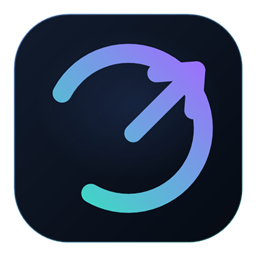

# Obxodik Windows

**Android-версия:** [Obxodik-Android](https://github.com/tokhirdzhon/Obxodik-Android) · [Скачать APK](https://github.com/tokhirdzhon/Obxodik-Android/releases/latest)  
**Скачать установщик:** [Obxodik-Setup-1.1.0.exe](https://github.com/tokhirdzhon/Obxodik-Windows/releases/latest)

Простой локальный инструмент для **YouTube**, **Discord** и **Telegram** на Windows 10/11.
Для YouTube и Discord Obxodik фрагментирует TCP/UDP-пакеты так, чтобы DPI провайдера
не распознавал соединение. Для Telegram дополнительно есть локальный MTProto → WebSocket
прокси, который помогает при блокировке по IP. VPN и сторонние VPN-серверы не используются.



## Что умеет

- Отдельные переключатели для YouTube, Discord и Telegram. Выключенный сервис не затрагивается.
- Один локальный процесс `winws.exe` (движок zapret) с отдельными профилями под каждый сервис.
- Четыре стратегии обхода: multisplit, fake TLS, fake+fakedsplit, fake TLS auto.
- Три режима IPSet: **loaded** (только IP из списка), **any** (все IP), **none** (IP-фильтр выключен).
- **WS-прокси для Telegram** — локальный MTProto → WebSocket мост, который помогает при блокировке по IP.
- Автозапуск с Windows через планировщик задач (с правами администратора, без окна).
- Проверка доступности YouTube, Discord и Telegram встроенными средствами.
- Журнал движка, сворачивание в трей, автоматический перезапуск после сна.
- Установщик NSIS с ярлыками и штатным удалением.

## Установка

1. Скачайте `Obxodik-Setup-1.1.0.exe` из папки `dist`.
2. Запустите установщик и подтвердите запрос UAC.
3. После установки приложение откроется и сразу включит обход для всех трёх сервисов.
4. Выключите ненужные сервисы переключателями.

Установка выполняется в `C:\Program Files\Obxodik`. Настройки и журнал хранятся в
`%APPDATA%\Obxodik`.

## Как это работает

```
YouTube / Discord / Telegram
        │
        ▼
   WinDivert (драйвер перехвата)
        │
        ▼
   winws.exe (zapret): split / fake / disorder
        │
        ▼
   DPI провайдера видит только фрагменты
        │
        ▼
   Целевой сервер собирает исходный запрос
```

Для каждого включённого сервиса формируется собственный набор фильтров:

| Сервис | Что фильтруется | Обход |
|---|---|---|
| YouTube | домены YouTube/Googlevideo, TCP 80/443, QUIC UDP 443 | multisplit/fake TLS + fake QUIC |
| Discord | домены Discord, TCP 80/443/2053/2083/2087/2096/8443, голосовые UDP-порты | split/fake + fake Discord/STUN |
| Telegram | домены Telegram + официальные подсети, TCP 80/443 | protocol-agnostic multisplit |

Глобальные порты перехвата: TCP `80,443,2053,2083,2087,2096,8443`,
UDP `443,19294-19344,50000-50100`. Фильтры по доменам и IP не дают движку
трогать остальной трафик.

### Режимы IPSet

Настройка «Фильтр IPSet» управляет общим IP-слоем:

| Режим | Что делает |
|---|---|
| `loaded` | Обрабатывает только IP из `ipset-all.txt` (список заблокированных ресурсов) |
| `any` | Обрабатывает все IP на портах обхода. Может затронуть лишний трафик |
| `none` | IP-фильтрация отключена, работают только профили по доменам |

`loaded` — режим по умолчанию. `ipset-all.txt` взят из сборки Flowseal и содержит
актуальный список подсетей. В режиме `any` приватные сети исключены через
`ipset-exclude.txt`.

### Telegram WS-прокси

Для Telegram дополнительно доступен локальный прокси-мост, собранный из
[Flowseal/tg-ws-proxy](https://github.com/Flowseal/tg-ws-proxy) (MIT):

```
Telegram Desktop → 127.0.0.1:1443 (MTProto) → tgws-core.exe
     → WebSocket/TLS через разрешённые домены → WS-шлюз Telegram
```

- Прокси слушает только `127.0.0.1`, секрет генерируется случайно и хранится локально.
- Трафик упаковывается в WebSocket поверх TLS и уходит через домены, которые
  обычно не блокируются. Сторонний VPN-сервер не используется.
- Включите переключатель «Telegram WS-прокси» — Obxodik запустит прокси и, если Telegram
  установлен, откроет ссылку `tg://proxy`. Подтвердите подключение в приложении.
- Если ссылка не сработала, нажмите «Копировать ссылку» и отправьте её себе в
  «Избранное», затем откройте на телефоне/в Desktop.
- Порт по умолчанию — `1443`; если он занят, Obxodik выберет свободный и покажет его в интерфейсе.
- После выхода из Obxodik настройка прокси остаётся в Telegram. Если приложение не запущено,
  отключите прокси в Telegram (Настройки → Продвинутые настройки → Тип подключения),
  иначе мессенджер может не подключаться.

WS-прокси не заменяет VPN и не восстанавливает звонки: MTProto-прокси в Telegram
не проксирует звонки. Для звонков нужен полноценный VPN.

## Если что-то не работает

1. **Смените стратегию** в настройках. Рабочая стратегия зависит от провайдера и меняется со временем.
2. **Проверьте Secure DNS** в браузере или Windows 11 (DNS-over-HTTPS). Это важно для YouTube.
3. **Telegram.** С 2026 года мессенджер блокируется в РФ по IP, а не только по DPI. Включите
   «Telegram WS-прокси» в настройках — это локальный MTProto → WebSocket мост. Если он не помогает,
   используйте внешний MTProto-прокси («Внешний MTProto-прокси») или полноценный VPN.
   Звонки через MTProto-прокси не работают — для них нужен VPN.
4. **Discord.** Очистите кэш клиента (`%APPDATA%\discord\Cache`, `Code Cache`, `GPUCache`) и перезапустите его.
5. **Антивирус.** WinDivert иногда определяется как RiskTool. Добавьте папку установки в исключения.
6. **SmartScreen.** Установщик не подписан коммерческим сертификатом, поэтому Windows может показать
   «Неизвестный издатель». Это ожидаемо для открытой сборки; проверьте SHA256 установщика.
7. **Ошибка прав.** Приложение требует администратора: без него WinDivert не загрузится.

## Сборка из исходников

Требования: Node.js 20+, Windows 10/11.

```powershell
npm install
npm test
npm start          # запуск в режиме разработки (нужен запуск от администратора)
npm run dist       # сборка установщика в dist/
```

Готовый headless-прокси `resources/tgws/tgws-core.exe` уже включён в репозиторий.
Пересобрать его из исходников Flowseal можно командой:

```powershell
powershell -NoProfile -ExecutionPolicy Bypass -File tools\build-tgws.ps1
```

В режиме разработки автозапуск и перезапуск с правами администратора ограничены.
Для полноценной проверки используйте собранный установщик.

## Структура проекта

```
electron/          главный процесс, IPC, движки, профили, WS-прокси
ui/                интерфейс (HTML/CSS/JS без фреймворков)
resources/zapret/  winws.exe, WinDivert, cygwin, фейковые пакеты и списки
resources/tgws/    headless-сборка tg-ws-proxy и её лицензия
tests/             тесты сборки аргументов и целостности бандла
build/             лицензия для установщика
tools/             генерация иконки и сборка WS-прокси
```

## Ограничения и честность

- Obxodik не заменяет VPN: DPI-обход не скрывает IP и не обходит блокировки по IP-адресу.
- WS-прокси для Telegram помогает при IP-блокировках, но зависит от доступности
  Cloudflare/WS-шлюзов и не проксирует звонки.
- Эффективность зависит от оборудования провайдера. Стратегии могут переставать работать.
- Приложение не устанавливает службу и не изменяет системные настройки, кроме задачи автозапуска
  (включается вручную) и временной загрузки драйвера WinDivert движком.
- Windows 7 не поддерживается.

## Лицензии

Код Obxodik — MIT. Движок zapret — MIT (bol-van, Flowseal), WinDivert — LGPL,
TG WS Proxy — MIT (Flowseal). Подробности: [THIRD_PARTY_NOTICES.md](THIRD_PARTY_NOTICES.md).

## Источники

- zapret: https://github.com/bol-van/zapret
- Сборка и списки: https://github.com/Flowseal/zapret-discord-youtube
- Документация winws: https://github.com/bol-van/zapret/blob/master/docs/readme.md
- TG WS Proxy: https://github.com/Flowseal/tg-ws-proxy
- WinDivert: https://github.com/basil00/WinDivert
